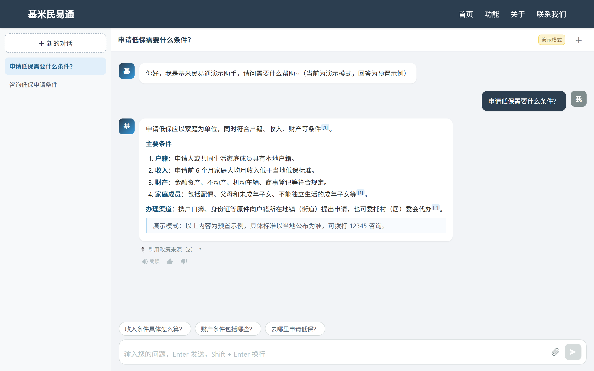
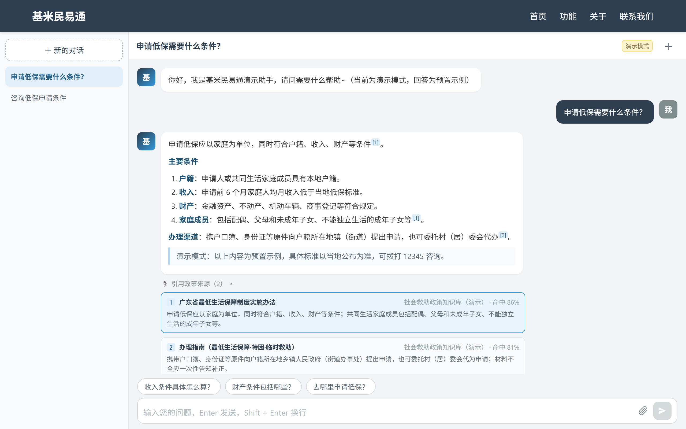
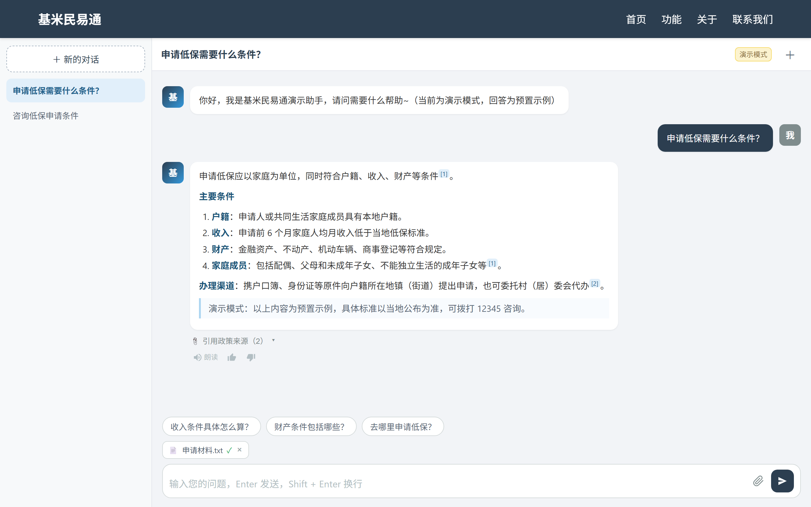

# 基米民易通 · 社会救助政策智能问答

面向佛山市南海区社会救助业务的问答智能体：把分散在政策文件、办事指南、镇街联系方式中的内容整理成知识库，通过 RAG 工作流回答「低保、特困、临时救助、医疗/教育/住房/就业救助」等问题，并提供可溯源的 Web 对话界面。

- 智能体平台：Dify 1.9.1（Docker Compose）
- 应用：`基米民易通beta1.3.0`（app_id `e00b0aab-64a0-4685-b690-043a24a69a6b`）
- 前端：Vue 3 + Vite + Pinia（**已经是 Vue 3，不需要再换框架**；早期 iframe 嵌入 Dify 的副本已归档）

## 在线演示与本地预览

- **在线演示（GitHub Pages）**：https://zhai-1234.github.io/jimi-minyitong/ —— 演示模式，使用预置回答，不连接 Dify，界面有「演示模式」标识。
- **本地演示**（无需 Dify、无需 API 密钥）：

```bash
cd frontend
npm install
npm run dev:demo
```

演示模式覆盖流式输出、引用角标联动、来源面板、建议问题、朗读（浏览器语音合成）、附件上传（模拟），语音输入关闭（无真实识别服务）。

## 界面预览

| 对话、引用角标与建议问题 | 政策来源面板（点击角标联动高亮） |
| --- | --- |
|  |  |



> 截图来自演示模式，回答为预置示例，不代表真实政策答复。

## 架构（文字版）

```
用户浏览器
   │ HTTP / SSE
   ▼
frontend/  Vue 3 SPA（流式对话、来源面板、朗读、语音输入、文件上传、建议问题）
   │  /v1 由 Vite 代理（开发）或 Nginx 反向代理（生产）
   ▼
Dify 1.9.1（docker-nginx-1 → docker-api-1 / docker-web-1）
   ├─ 应用工作流（9 节点）
   │    开始 → 迭代（文件提取）→ 问题分析（LLM，输出 3 个检索词）
   │         → 数组（code，输出 result / query）→ 知识检索（hybrid，top_k=4）
   │         → LLM（回答 ≤350 字，上下文直接绑定检索结果数组 → 生成引用）
   │         → 直接回复
   ├─ 知识库 dataset 452cebfd…：原政策文档 + 归纳文档 + 办理指南，嵌入 text-embedding-v1
   └─ PostgreSQL / Redis / Weaviate / 插件守护进程（deepseek、tongyi 等）

backend/（可选）Spring Boot 3.5：/api/chat-messages 问答日志落库与查询
evaluation/      仅依赖 Python 标准库的 RAG 评测体系（50 题、6 类场景）
```

## 三部分启动方式

### 1. Dify 平台

```bash
cd /e/dify-main/docker
docker compose up -d
```

控制台 http://localhost ，服务 API 前缀 http://localhost/v1 。

> 容器重建会丢失 `deal_dataset_vector_index_task.py` 的补丁（修复重建索引 `DetachedInstanceError`），需要重新打补丁；原文件备份见 `evaluation/diagnostics/deal_dataset_vector_index_task.py.orig`。

### 2. 前端（唯一在用界面）

```bash
cd frontend
npm install
cp .env.example .env      # 填入 Dify 应用 API 密钥，勿提交
npm run dev               # http://localhost:5173
```

`.env` 关键项：`VITE_DIFY_API_KEY`（应用密钥）、`VITE_DIFY_API_BASE=/v1`、`VITE_DIFY_PROXY_TARGET=http://localhost`。

### 3. 后端（可选，默认关闭）

```bash
cd backend
mysql -u root -p < src/main/resources/db/schema.sql
mvnw.cmd spring-boot:run          # Windows；macOS/Linux 用 ./mvnw spring-boot:run
```

前端在 `.env` 中设 `VITE_BACKEND_ENABLED=true` 后，每轮问答会异步上报落库。是否需要保留后端见 [docs/架构决策-是否需要后端.md](docs/架构决策-是否需要后端.md)。

### 4. 评测

```bash
cd evaluation
python run_eval.py --mode real --label baseline
```

（需先设置 `DIFY_API_KEY`、`DIFY_API_BASE` 环境变量。）

## 评测结果（2026-11-13 最终配置）

50 题、六类场景（单政策 / 多政策 / 口语化 / 粤语 / 超纲 / 边界）：

| 指标 | 结果 |
| --- | --- |
| 关键要点召回率 | **95.3%** |
| 来源命中率 | **97.7%**（优化前 72.1%） |
| 拒答正确率 | **100%** |
| 平均延迟 / P95 | **6.6 s / 8.4 s** |

完整的优化过程（延迟优化、引用修复、来源优化、嵌入模型实验矩阵、办理指南补充）见 [evaluation/README.md](evaluation/README.md)。

## 目录说明

| 路径 | 说明 |
| --- | --- |
| `frontend/` | Vue 3 前端（原 `ai-vue`），流式对话 + 来源 + 朗读 + 语音输入 + 文件上传 |
| `backend/` | 可选 Spring Boot 问答日志服务（原 `ai-vue/ai-spring/demo`） |
| `dify/` | 工作流 DSL `基米民易通beta1.3.0.yml`、智能体建设方案、索引补丁（`patches/`，含脚本与 compose 挂载） |
| `evaluation/` | 测试集、评测脚本、结果与诊断快照 |
| `docs/` | 项目说明、架构决策、简历材料、项目知识文档与界面截图 |
| `_archive/` | 旧前端副本 `111-legacy/`、旧 IDE 元数据、数据库改动前备份 |
| `社会救助/` | 原始政策文件（知识库来源，PDF 等） |
| `基米补充材料/` | 知识库/工作流/粤语交流截图等过程材料 |
| `ku申请资料/`、`微信视频…mp4` | 与项目无关的个人材料，未改动 |

## 常见问题

1. **Dify 预览页标题显示「beta1.2.2」**
   预览页标题取自数据库 `sites.title`，不是应用名。该字段在复制应用时没有随应用改名，已修正为 `基米民易通beta1.3.0`；旧副本已重命名为 `基米民易通beta1.2.2-归档`。改动前记录备份在 `_archive/db-backups-2026-11-13/`。

2. **回答后的「建议问题」为空**
   平台默认 LLM 原配置为不存在的 `qvq-max`（404），导致建议问题与会话命名静默失败。已在 `tenant_default_models` 中把 text-generation 默认模型改为 `deepseek-chat`。

3. **语音输入识别结果为空**
   默认语音识别模型 `paraformer-realtime-v1` 对上传音频返回空文本，已切换为 `paraformer-realtime-v2`；同时前端会把浏览器录音（webm）转成 16 kHz 单声道 WAV 再上传，因为 Dify 1.9.1 只接受 mp3/m4a/wav/amr/mpga。

4. **来源面板为空 / SSE 不增量**
   Dify 新版把事件名放在 `data.event` 中，前端已兼容；Nginx 代理需 `proxy_buffering off`。

5. **重建知识库索引卡住（DetachedInstanceError）**
   Dify 1.9.1 缺陷。补丁与安装方式已固化在 [dify/patches/](dify/patches/README.md)：推荐用 `docker-compose.patch.yml` 挂载（容器重建不丢），或运行 `apply-index-patch.sh` / `.ps1`。

6. **中文关键词检索无结果**
   知识库 hybrid 中的 BM25 对中文实际返回空，当前效果主要由向量检索贡献；重排（gte-rerank）曾静默失败已关闭。

7. **对话报 HTTP 500，或文件上传按钮消失**
   先确认 Docker Desktop 与 Dify 容器已启动（`docker compose up -d`）。Dify 不可用时 Vite 代理会返回 500，`/parameters` 失败会导致上传入口缺失。前端会缓存上次应用参数并在顶部提示「无法连接智能体服务」，启动 Dify 后点「重试」即可恢复。

## 2026-11-13 目录调整

`ai-vue/` → `frontend/`；`ai-vue/ai-spring/demo` → `backend/`；DSL 与建设方案移入 `dify/`；旧副本 `111/` 移入 `_archive/111-legacy/`。移动前后未删除任何文件，前端与 Spring Boot 的启动命令已在上文同步更新。
